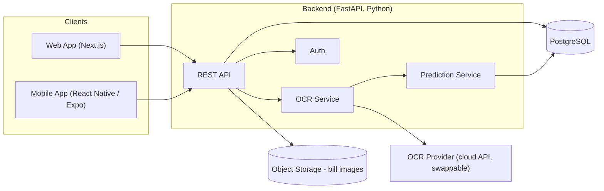

# BillSplit — Architecture

## 1. Overview

BillSplit lets a user create a group of people, capture each person's usual
preferences, and upload a photo of a bill. The system extracts line items
from the image, predicts which items belong to which person (using stated
preferences plus learned history from past bills), and produces an accurate
split. It ships as a web app and a mobile app sharing one backend.

**Core goals**
- Correctly split a bill with minimal manual tagging.
- Get smarter per group over time (learn from corrections/history).
- Ship on web and mobile from one codebase where possible.
- Be deployable end-to-end on low-cost/free-tier infrastructure, since this
  is also a learning project.

**Non-goals (v1)**
- Payment processing / settling money (Splitwise-style IOU tracking only).
- Multi-currency, tax/tip jurisdiction rules beyond simple % tip/tax.
- Real-time multi-user collaborative editing of a bill.

---

## 2. High-Level System Diagram



---

## 3. Recommended Tech Stack

| Layer | Choice | Why |
|---|---|---|
| Web frontend | **Next.js (React, TypeScript)** | Mainstream, huge learning resources, deploys free on Vercel, good for a receipt-upload/results UI. |
| Mobile frontend | **React Native + Expo (TypeScript)** | Shares component logic and types with the web app; Expo makes device build/deploy far simpler than bare native for a solo learner. |
| Backend | **Python + FastAPI** | Python is the natural home for OCR/ML work — you'll be gluing together OCR output and a prediction model, and FastAPI gives you async REST + auto-generated OpenAPI docs with little ceremony. |
| Database | **PostgreSQL** | The data (groups, people, bills, items, splits, history) is relational by nature; Postgres is free-tier friendly on Supabase/Neon/Railway. |
| Image storage | **S3-compatible object storage** (S3, or Supabase Storage) | Bill photos shouldn't live in the DB; keep the DB storing metadata + a storage URL. |
| Auth | **JWT-based auth** (or Supabase Auth / Clerk to start) | Keep it simple at first; swap in a managed provider so you're not hand-rolling password storage. |
| Hosting | Web → Vercel · Backend → Railway/Render/Fly.io · DB → Supabase/Neon · Mobile → Expo EAS | All have workable free tiers for a learning-stage deployable project. |

You don't have to lock every choice today — but backend-in-Python and a
shared-TS-frontend split (Next.js + React Native) is the pairing that best
serves both "learn ML/OCR properly" and "ship on web and mobile without
maintaining three separate frontends."

---

## 4. Bill-Parsing Strategy (the interesting part)

Splitting this into two problems, solved two different ways, is the
recommended strategy:

**4a. Text extraction (OCR) — use a mature provider, don't reinvent it**
Reading text off a photographed receipt reliably (skew, lighting, thermal-
printer fading) is a solved, data-hungry problem. Recommendation: start
with a cloud OCR API (Google Cloud Vision, AWS Textract, or Azure Document
Intelligence all have receipt-aware modes) behind an `OCRProvider`
interface in the backend, so it's swappable later. Optionally add a local
Tesseract fallback so you understand the fundamentals, but don't spend your
learning budget on building a receipt-OCR model from scratch — the payoff
is low relative to effort.

**4b. Item → person prediction — this is where you build your own model**
This is BillSplit's actual differentiator and the best place to invest
learning effort:
1. **v1 (rule-based / heuristic):** After OCR gives you line items, use
   stored per-person preferences (e.g. "usually orders the vegetarian
   option", "never orders alcohol") plus simple keyword matching to
   suggest assignments; the user confirms/corrects before finalizing.
2. **v2 (learned model):** Log every confirmed/corrected split as labeled
   training data (item text/category → person, per group). Once you have
   enough history, train a classifier (start simple — logistic
   regression or gradient boosting over item text embeddings + group
   history features — before reaching for a neural net) to predict
   assignment, falling back to the v1 heuristic for cold-start groups/items.
3. Always keep a human-confirmation step in the loop; treat the model's
   output as a suggestion, not an auto-commit, especially early on.

This phased approach gets you a working, deployable product fast (v1) while
giving you a genuine, well-scoped ML project (v2) instead of an open-ended
OCR research problem.

---

## 5. Core Data Model (entities, not full schema)

- **User** — the account holder using the app.
- **Group** — a set of people who split bills together; owned by a User.
- **Person** — a member of a Group (may or may not be a registered User);
  holds `preferences` (free text + structured tags).
- **Bill** — an uploaded receipt: image reference, merchant, date, totals
  (subtotal, tax, tip), status (processing/needs review/finalized).
- **BillItem** — a line item on a Bill: raw OCR text, parsed name, price,
  quantity, predicted/assigned Person(s).
- **Split** — the final computed share per Person for a Bill (derived from
  BillItems + tax/tip allocation rules).
- **PredictionFeedback** — records of corrections made to predicted
  assignments; this is the training signal for the v2 model.

---

## 6. API Shape (principles, not full contract)

- REST over HTTPS, JSON, versioned under `/api/v1`.
- Bill upload is async: `POST /bills` returns immediately with a
  `processing` status; client polls or subscribes (websocket/SSE later)
  for OCR + prediction completion.
- Every predicted assignment is returned with a confidence score and stays
  editable until the bill is finalized.
- Backend never blocks a request on the OCR provider inline for large
  images — queue it (even a simple background task queue like Celery/RQ,
  or FastAPI `BackgroundTasks` for v1) so the API stays responsive.

---

## 7. Cross-Cutting Concerns

- **Privacy:** bill images may contain sensitive purchase data (alcohol,
  medical items, etc.) — store images with per-user access control, and
  decide a retention/deletion policy before launch, not after.
- **Auth & authorization:** a Person's data is only visible to Users in
  their shared Group(s); enforce this at the API layer, not just the UI.
- **Observability:** structured logging around the OCR → prediction
  pipeline from day one — this pipeline is exactly where things will
  silently go wrong (bad OCR read, wrong split) and you'll want to debug
  it against real receipts.
- **Testing:** unit tests for split-calculation math (rounding/tax/tip
  allocation is a classic source of off-by-cent bugs); a fixture set of
  sample receipt images + expected OCR/split output for regression testing
  of the pipeline.

---

## 8. Suggested Repo Layout

```
billsplit/
  apps/
    web/          # Next.js app
    mobile/       # Expo app
  packages/
    shared-types/ # TS types shared between web & mobile (and mirrored in API schema)
  backend/
    app/
      api/
      services/
        ocr/
        prediction/
      models/
      db/
    tests/
  docs/
    architecture.md
```

---

## 9. Open Decisions (revisit as the project develops)

- Which OCR provider to start with, and its free-tier limits.
- Managed auth provider vs. hand-rolled JWT.
- When to introduce a real task queue vs. `BackgroundTasks`.
- How much history is "enough" before switching a group from v1 heuristic
  to the v2 learned model.
